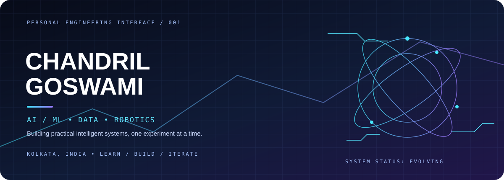
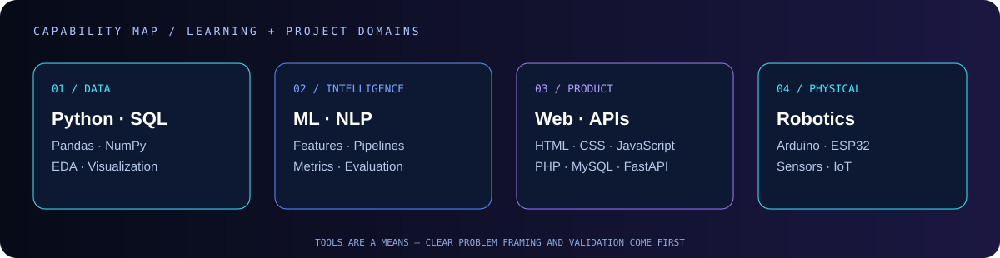
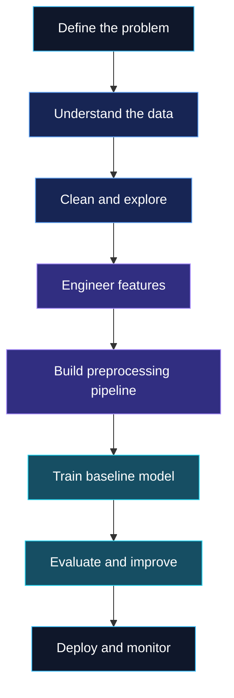

<table>
<tr>
<td width="62%" valign="middle" align="left">

### `AI / ML ENGINEER IN TRAINING`

BCA (Honours) · Machine Learning · EIILM-Kolkata  
📍 Kolkata, India

I build practical projects across **machine learning, data, web engineering, and robotics**. I enjoy understanding the problem, exploring the data, building solutions, and learning through real implementation.

</td>
<td width="38%" align="center" valign="middle">

PERSONAL AVATAR · AI ENGINEERING PROFILE

</td>
</tr>
</table>

### `PROFILE SIGNAL / PERSONAL VISUAL`

PERSONAL ARTWORK · NEON BLUE × RED RIM LIGHTING

**DESIGN · DEVELOP · EXPERIMENT · ITERATE**

---

## `01 / SYSTEM IDENTITY`

<table>
<tr>
<td width="58%" valign="top">

### Curious by nature. Technical by choice.

- 🧠 Exploring machine learning, NLP, and predictive analytics
- 📊 Practising data cleaning, feature engineering, and model evaluation
- 🛠️ Developing responsive web applications and database-driven systems
- 🤖 Experimenting with Arduino, sensors, and robotics
- 🚀 Learning through projects, iteration, and measurable improvements

> **Engineering principle:** Learn deeply. Build often. Measure honestly. Improve continuously.

</td>
<td width="42%" valign="top" align="center">

</td>
</tr>
</table>

## `02 / TECHNOLOGY MATRIX`

### AI, Machine Learning & Data

### Web Engineering & Databases

### Robotics & Tools

---

## `03 / PROJECT DOCK`

<table>
<tr>
<td width="50%" valign="top">

### 🤖 IoT & Robotics Guide

Hands-on learning around IoT, robotics hardware, and practical engineering experiments.

[**↗ Repository**](https://github.com/Chandril6290Da/Iot-robotics-GUIDE) · [**↗ Live Demo**](https://chandril6290da.github.io/Iot-robotics-GUIDE/)

</td>
<td width="50%" valign="top">

### 🧠 RabTech AI/ML Internship

Applied AI/ML internship work covering problem framing, responsible data documentation, preprocessing, and model experiments.

[**↗ Explore Repository**](https://github.com/Chandril6290Da/RabTech-AI-ML-Internship)

</td>
</tr>
<tr>
<td width="50%" valign="top">

### 📊 Data & Predictive Analytics

Working through exploratory analysis, feature relationships, preprocessing, and model evaluation.

</td>
<td width="50%" valign="top">

### ⚙️ Intelligent Web Applications

Building responsive interfaces with application logic, data handling, and database fundamentals.

</td>
</tr>
</table>

EXPLORE THE PROJECTS · FOLLOW THE BUILD LOG

## `04 / MACHINE LEARNING PIPELINE`

**Approach:** Establish a baseline, prevent data leakage, choose meaningful metrics, and use evidence to improve the model.

## `05 / GITHUB TELEMETRY`

 

Statistics are served by third-party services and may occasionally be unavailable. Language breakdown is not a measure of proficiency.

## `06 / CURRENT MISSION`

- [ ] Strengthen machine learning fundamentals
- [ ] Build reliable, leak-free preprocessing pipelines
- [ ] Improve evaluation and experiment tracking
- [ ] Develop interactive AI/ML demonstrations
- [ ] Explore deployment and API integration
- [ ] Expand robotics and IoT experiments

## `07 / CONNECT TO ENGINEER`

  

**`END OF TRANSMISSION // KEEP BUILDING.`**

Designed with curiosity. Engineered through practice.

