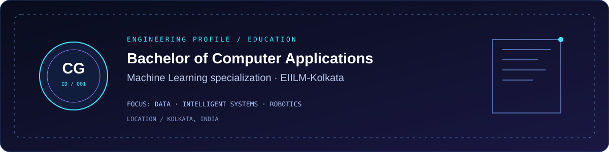

# CHANDRIL GOSWAMI
### AI / ML Engineer · Intelligent Systems Builder · Robotics Explorer

<p align="center">
  
</p>

<p align="center">
  <a href="https://github.com/Chandril6290Da">
    
  </a>
  <a href="mailto:chandrilgoswamiofficial6290@gmail.com">
    
  </a>
  
  
</p>

---

## `01` — SYSTEM PROFILE

<p align="center">
  
</p>

I'm **Chandril Goswami**, a BCA (Honours) student specializing in Machine Learning, interested in building practical intelligent systems that connect data, software, and the physical world.

My approach is simple: understand the problem, prepare the data, build the solution, evaluate the results, and improve through experimentation.

- **Core interest:** Artificial Intelligence and Machine Learning
- **Data:** Data cleaning, preprocessing, analysis, and visualization
- **Development:** Python, SQL, web technologies, and APIs
- **Robotics:** Arduino, ESP32, sensors, and embedded systems
- **Current direction:** Developing end-to-end ML projects and strengthening model deployment skills
- **Based in:** Kolkata, West Bengal, India

> Learn deeply. Build often. Keep improving.

---

## `02` — TECH STACK

<p align="center">
  
</p>

### AI, Machine Learning & Data

<p>
  
  
  
  
  
  
  
</p>

**Focus areas:** Data preprocessing, feature engineering, missing-value imputation, encoding, scaling, classification, regression, model evaluation, NLP fundamentals, and exploratory data analysis.

### Web Development & Databases

<p>
  
  
  
  
  
  
  
</p>

### Robotics & Embedded Systems

<p>
  
  
  
  
  
</p>

### Tools & Workflow

<p>
  
  
  
  
  
  
</p>

---

## `03` — FEATURED PROJECTS

<p align="center">
  
</p>

### 01. AI / ML Internship Projects

**Repository:** [RabTech-AI-ML-Internship](https://github.com/Chandril6290Da/RabTech-AI-ML-Internship)

A project-based workspace for learning and implementing machine learning workflows.

- Problem framing and dataset understanding
- Responsible data documentation and risk assessment
- Data preprocessing and model development
- Model comparison and evaluation
- NLP classification experiments
- API-based deployment practice

**Technologies:** Python · Pandas · scikit-learn · NLP · FastAPI

### 02. IoT & Robotics Learning Resource Map

**Repository:** [IoT & Robotics Guide](https://github.com/Chandril6290Da/Iot-robotics-GUIDE) · [Live Demo](https://chandril6290da.github.io/Iot-robotics-GUIDE/)

An interactive learning resource map that organizes tutorials, repositories, and learning paths from beginner to advanced topics.

- Searchable learning resources
- Filters for language, content type, and skill level
- Learning paths across IoT, embedded systems, robotics, and AI
- Responsive web interface

**Technologies:** HTML5 · CSS3 · JavaScript

### 03. Library Management System

**Repository:** [Library Management System](https://github.com/Chandril6290Da/LIABREY_MANGEMENT_SYSTEM)

A menu-driven C application for managing library books, members, and issue/return operations.

- Book and member records
- Search and availability tracking
- Issue and return workflows
- File-based data persistence

**Technologies:** C · Structures · File Handling

### 04. Data Analytics & Machine Learning Experiments

A growing collection of experiments focused on transforming raw data into useful insights and building predictive models.

Areas of exploration:

- Exploratory data analysis
- Data cleaning and feature engineering
- Classification and regression
- Model evaluation and comparison
- Data visualization and dashboard design

*Explore my repositories for the latest published implementations.*

---

## `04` — MACHINE LEARNING WORKFLOW

```text
PROBLEM DEFINITION
       |
       v
DATA COLLECTION & UNDERSTANDING
       |
       v
DATA QUALITY & EXPLORATORY ANALYSIS
       |
       v
PREPROCESSING & FEATURE ENGINEERING
       |
       v
TRAIN / TEST SPLIT
       |
       v
MODEL TRAINING & VALIDATION
       |
       v
EVALUATION & ERROR ANALYSIS
       |
       v
DEPLOYMENT & MONITORING
       |
       v
ITERATION AND IMPROVEMENT
```

My goal is to understand the **complete machine learning lifecycle**, not just model training: from identifying the right problem and preventing data leakage to evaluating performance and building usable applications.

---

## `05` — GITHUB ANALYTICS

<p align="center">
  
  
</p>

<p align="center">
  
</p>

<p align="center">
  
</p>

*Note: These analytics are provided by external services. They may occasionally load slowly or be unavailable.*

---

## `06` — CURRENT MISSION

<p align="center">
  
</p>

- Strengthen machine learning fundamentals through hands-on implementation.
- Build robust preprocessing and model evaluation pipelines.
- Learn to serve models through APIs and deployment workflows.
- Explore the intersection of AI, IoT, and robotics.
- Develop projects that solve practical problems and demonstrate measurable value.

---

## `07` — LET'S CONNECT

I'm interested in AI/ML opportunities, collaborative projects, technical learning, and building useful intelligent systems.

<p align="center">
  <a href="https://github.com/Chandril6290Da">
    
  </a>
  <a href="mailto:chandrilgoswamiofficial6290@gmail.com">
    
  </a>
</p>

<p align="center">
  <b>BUILD → LEARN → EXPERIMENT → IMPROVE</b>
</p>

<p align="center">
  <i>Engineering tomorrow, one experiment at a time.</i>
</p>
