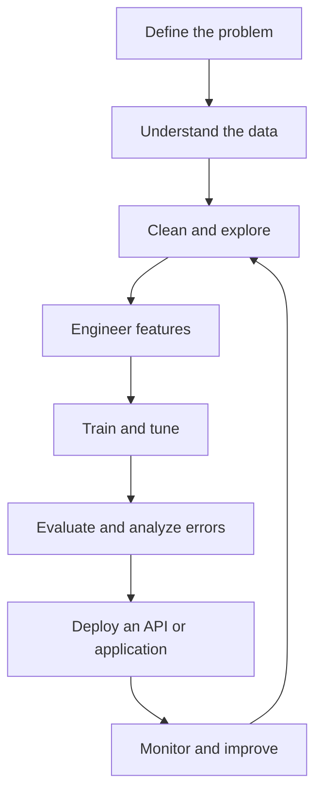

<div align="center">


[](https://github.com/Chandril6290Da)
[](mailto:chandrilgoswamiofficial6290@gmail.com)
[](https://www.linkedin.com/in/chandrilgoswami)


</div>

---

## 01 / Neural Systems


I'm **Chandril Goswami**, a BCA student specializing in Machine Learning at EIILM-Kolkata. I focus on building practical projects across machine learning, data analysis, NLP, web development, and robotics.

- **Focus:** Machine Learning, Data Science, NLP, Robotics and IoT.
- **Current direction:** Leak-free preprocessing pipelines, model evaluation, and deployment-oriented projects.
- **Engineering loop:** Understand → Prepare → Build → Evaluate → Improve → Deploy.
- **Location:** Kolkata, West Bengal, India.

```text
DATA  →  LEARNING  →  PREDICTION
  ↓          ↓            ↓
ANALYSIS → OPTIMIZATION → APPLICATION
```

## 02 / Stack Orbit


| Domain | Tools and topics |
|---|---|
| Programming & data | Python, SQL, Pandas, NumPy, Matplotlib, Excel |
| Machine Learning | Scikit-learn, classification, regression, feature engineering, model evaluation |
| AI & NLP | Text preprocessing, text classification, responsible AI fundamentals |
| Web development | HTML5, CSS3, JavaScript, Bootstrap, PHP, MySQL |
| Deployment fundamentals | FastAPI, REST APIs, Docker, reproducible workflows |
| Robotics & IoT | Arduino, ESP32, sensors, motor drivers, automation |
| Tools | Jupyter Notebook, Git, GitHub, VS Code, Power BI |

*These represent my learning and project areas; proficiency varies by technology.*

## 03 / Education & Engineering Principles


**Bachelor of Computer Applications (BCA)**  
**Specialization:** Machine Learning  
**Institution:** EIILM-Kolkata

My working principles:

- Understand concepts, not only library calls.
- Split data before fitting preprocessing steps to avoid leakage.
- Choose evaluation metrics that match the problem.
- Document assumptions, limitations, and reproducible steps.
- Consider fairness, privacy, and responsible use of data.
- Prefer useful, maintainable applications over unsupported performance claims.

### My machine-learning workflow

```text
01. Problem definition
02. Data collection and understanding
03. Data cleaning and exploratory analysis
04. Train/test split and feature engineering
05. Preprocessing pipeline
06. Model training and tuning
07. Evaluation and error analysis
08. API/application deployment
09. Monitoring and improvement
```

## 04 / Engineering Projects

| Project | What it explores | Repository |
|---|---|---|
| **IoT & Robotics Guide** | Interactive learning roadmap for IoT, embedded systems, robotics, and automation. | [Source](https://github.com/Chandril6290Da/Iot-robotics-GUIDE) · [Live demo](https://chandril6290da.github.io/Iot-robotics-GUIDE/) |
| **RabTech AI/ML Internship** | Project workspace for problem framing, preprocessing, model training, NLP, and deployment-oriented learning. | [Source](https://github.com/Chandril6290Da/RabTech-AI-ML-Internship) |
| **Maze-solving robotics concept** | Maze navigation logic using sensor-driven decisions and motor-control concepts. | [Explore repositories](https://github.com/Chandril6290Da?tab=repositories) |
| **Machine-learning experiments** | Data preparation, predictive modelling, feature engineering, and evaluation practice. | [Explore repositories](https://github.com/Chandril6290Da?tab=repositories) |

### Build lifecycle



## 05 / Recruiter Dashboard

<div align="center">


[View GitHub activity and repositories →](https://github.com/Chandril6290Da?tab=overview)

</div>

<sub>GitHub stats and contribution graphics rely on third-party services and may occasionally be unavailable. Metrics are not hard-coded; no unverified achievements or counts are claimed.</sub>

## Current Build Log

```text
[01] LEARN       → Strengthen ML and statistical foundations
[02] ENGINEER    → Build reliable preprocessing pipelines
[03] EXPERIMENT  → Compare features, models, and evaluation metrics
[04] DEPLOY      → Practice APIs and reproducible deployments
[05] DOCUMENT    → Make projects clear, useful, and maintainable
```

## Let's Connect


<div align="center">

[](https://github.com/Chandril6290Da)
[](mailto:chandrilgoswamiofficial6290@gmail.com)
[](https://www.linkedin.com/in/chandrilgoswami)

**Building today. Learning continuously. Engineering tomorrow.**

</div>

---

### Profile asset package

This profile uses five self-contained SVGs with embedded character artwork, CSS/SMIL-compatible animation, and relative paths. GitHub may render SVG animation differently across viewers; each image is designed to remain legible as a static image. The SVGs do not load external assets. The stats widgets and badges in this README are separate third-party services.

**Repository layout**

```text
.
├── README.md
└── assets/
    ├── hero.svg
    ├── about-life.svg
    ├── stack.svg
    ├── id-dashboard.svg
    ├── connect.svg
    ├── id.png
    └── right_pointing.png
```

**Publishing:** Upload `README.md` and the complete `assets/` folder to the root of the public repository named exactly `Chandril6290Da`. Do not upload only the ZIP. Commit the changes, then visit [your profile](https://github.com/Chandril6290Da) and check that all images and social links render correctly on desktop and mobile.
