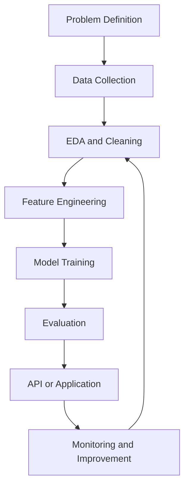

<div align="center">

  

  

  <br/><br/>

  <a href="https://github.com/Chandril6290Da">
    
  </a>
  <a href="mailto:chandrilgoswamiofficial6290@gmail.com">
    
  </a>

  <br/><br/>

  
  

</div>

---

# 01 / NEURAL SYSTEMS

> Engineering practical intelligence through code, experimentation, and continuous learning.

I'm **Chandril Goswami**, a BCA professional focused on Machine Learning, intelligent systems, data analysis, and robotics. I enjoy transforming technical concepts into practical projects and exploring how software, data, and hardware work together.

- **Focus:** Machine Learning, data science, NLP, and robotics.
- **Currently developing:** ML preprocessing workflows and deployment-oriented projects.
- **Engineering mindset:** Understand → Prepare → Build → Evaluate → Improve → Deploy.
- **Location:** Kolkata, West Bengal, India.

```text
┌────────────────────────────────────────────────────┐
│               INTELLIGENT SYSTEMS                  │
├────────────────────────────────────────────────────┤
│                                                    │
│   DATA ──────► LEARNING ──────► PREDICTION         │
│     │              │                │              │
│     ▼              ▼                ▼              │
│  ANALYSIS      OPTIMIZATION     APPLICATION        │
│                                                    │
└────────────────────────────────────────────────────┘
```

# 02 / AI RESEARCH LAB

## Programming and data science

<p>
  
  
  
  
  
</p>

## Machine learning and AI

<p>
  
  
  
</p>

## Web development and databases

<p>
  
  
  
  
  
  
</p>

## Robotics and development tools

<p>
  
  
  
  
  
</p>

### Core engineering interests

| Domain | Focus areas |
|---|---|
| Machine Learning | Classification, regression, preprocessing, model evaluation |
| Data Science | Data cleaning, EDA, visualization, feature engineering |
| NLP | Text preprocessing, text classification |
| Deployment | REST APIs, FastAPI, Docker fundamentals |
| Robotics and IoT | Arduino, ESP32, sensors, motor drivers |
| Software Engineering | OOP, CRUD applications, databases, responsive design |

*My experience and proficiency vary across technologies; these are the areas I study and build projects in.*

# 03 / FUTURE ENGINEER

## Education

**Bachelor of Computer Applications (BCA)**  
**Specialization:** Machine Learning  
**Institution:** EIILM-Kolkata

### Engineering principles

- Understand concepts before relying on libraries.
- Build reproducible and well-documented experiments.
- Evaluate models using suitable metrics.
- Avoid data leakage and misleading performance claims.
- Consider limitations, fairness, and responsible AI.
- Turn experiments into useful applications.

### My ML workflow

```text
01. Problem Definition
          ↓
02. Data Collection and Understanding
          ↓
03. Data Cleaning and EDA
          ↓
04. Feature Engineering and Preprocessing
          ↓
05. Model Training and Tuning
          ↓
06. Evaluation and Error Analysis
          ↓
07. API / Application Deployment
          ↓
08. Monitoring and Improvement
```

# 04 / ENGINEERING PROJECTS

## Featured repositories

<table>
  <tr>
    <td width="50%" valign="top">
      <h3>🤖 IoT & Robotics Guide</h3>
      A learning resource for IoT, embedded systems, robotics, and automation.
      <br/><br/>
      <a href="https://github.com/Chandril6290Da/Iot-robotics-GUIDE">Explore repository →</a>
      <br/>
      <a href="https://chandril6290da.github.io/Iot-robotics-GUIDE/">View live demo →</a>
      <br/><br/>
      <sub>HTML · CSS · JavaScript · Robotics</sub>
    </td>
    <td width="50%" valign="top">
      <h3>🧠 RabTech AI/ML Internship</h3>
      Project workspace for problem framing, preprocessing, model training, NLP, and deployment-oriented learning.
      <br/><br/>
      <a href="https://github.com/Chandril6290Da/RabTech-AI-ML-Internship">Explore repository →</a>
      <br/><br/>
      <sub>Python · Scikit-learn · NLP · ML pipelines</sub>
    </td>
  </tr>
  <tr>
    <td width="50%" valign="top">
      <h3>🚗 Maze-Solving Robotics</h3>
      A robotics concept involving maze navigation, sensor-driven decisions, and motor control.
      <br/><br/>
      <a href="https://github.com/Chandril6290Da?tab=repositories">Explore repositories →</a>
      <br/><br/>
      <sub>Arduino · IR sensors · Motor drivers</sub>
    </td>
    <td width="50%" valign="top">
      <h3>📊 Machine Learning Experiments</h3>
      Experiments in data preparation, predictive modeling, feature engineering, and evaluation.
      <br/><br/>
      <a href="https://github.com/Chandril6290Da?tab=repositories">Explore repositories →</a>
      <br/><br/>
      <sub>Python · Pandas · Machine Learning</sub>
    </td>
  </tr>
</table>

### Project development lifecycle



# 05 / RECRUITER DASHBOARD

## GitHub statistics

<div align="center">
  
  
</div>

<div align="center">
  
</div>

### Contribution calendar

<div align="center">

  <a href="https://github.com/Chandril6290Da?tab=overview">
    
  </a>

  <br/>

  <a href="https://github.com/Chandril6290Da?tab=overview">
    View contribution history on GitHub →
  </a>

</div>

<sub>The contribution calendar uses an external image service. If it becomes unavailable, the link above still opens your GitHub profile. GitHub statistics are supplied by third-party services and may occasionally be unavailable.</sub>

---

## CURRENT BUILD LOG

```text
[01] LEARN       → Strengthen ML and statistical foundations
[02] ENGINEER    → Develop reliable preprocessing pipelines
[03] EXPERIMENT  → Test features, models, and evaluation metrics
[04] DEPLOY      → Explore APIs and reproducible deployments
[05] DOCUMENT    → Make projects clear, useful, and maintainable
```

## LET'S CONNECT

<div align="center">

  <a href="https://github.com/Chandril6290Da">
    
  </a>
  <a href="mailto:chandrilgoswamiofficial6290@gmail.com">
    
  </a>
  <a href="https://www.linkedin.com/in/chandrilgoswami">
    
  </a>

  <br/><br/>

  **Building today. Learning continuously. Engineering tomorrow.**

  <sub>Designed with curiosity and a passion for intelligent systems.</sub>

  <br/><br/>

  

</div>
